  <strong>B.Tech. Artificial Intelligence & Data Science | Data Science | Machine Learning | LLM & RAG | Agentic AI | Autonomous Systems | Software Development</strong>

## About Me

I am a B.Tech. Artificial Intelligence & Data Science student at **Kumaraguru College of Technology**.

My work focuses on **Robotics, Artificial Intelligence, Machine Learning, Data Science, LLM & RAG pipelines, and Software Development** with an emphasis on building real-world applications that bridge intelligent algorithms, hardware, and software.

## Focus Areas

  

## Tech Stack

### Languages

### AI / ML

### Robotics

### Web / Backend

### Tools

## Featured Projects

### 1. [KudoMate](https://github.com/Pavann-07/KudoMate)

> **Peer-accountable study rooms where completing tasks earns kudos.**

KudoMate is a web app designed to make productivity fun and accountable. Users can create or join study rooms, complete tasks, and earn or lose credits (kudos) based on their progress, built to encourage consistency, teamwork, and self-discipline through friendly peer motivation.

[View Repo](https://github.com/Pavann-07/KudoMate)

### 2. [VSLAM](https://github.com/Pavann-07/V-SLAM)

> **Autonomous rover navigation with Visual SLAM, Nav2, and real hardware deployment.**

Autonomous navigation using Visual SLAM, Nav2, Hybrid A*, and MPPI, deployed on real hardware: an **NVIDIA Jetson** paired with a **ZED 2i** stereo camera.

[View Repo](https://github.com/Pavann-07/V-SLAM)

### 3. [DocuHub](https://github.com/Pavann-07/Docu-Hub)

> **Multilingual document intelligence for English and Malayalam circulars, contracts, and scans.**

Built for **Smart India Hackathon 2025 (PS SIH25080)**, DocuHub helps people make sense of long circulars, contracts, meeting notes, and scanned notices in **English and Malayalam**. Upload a file to extract key dates, link related documents, and ask questions in plain English or Malayalam with line-level source citations.

[View Repo](https://github.com/Pavann-07/Docu-Hub)

## Connect With Me

